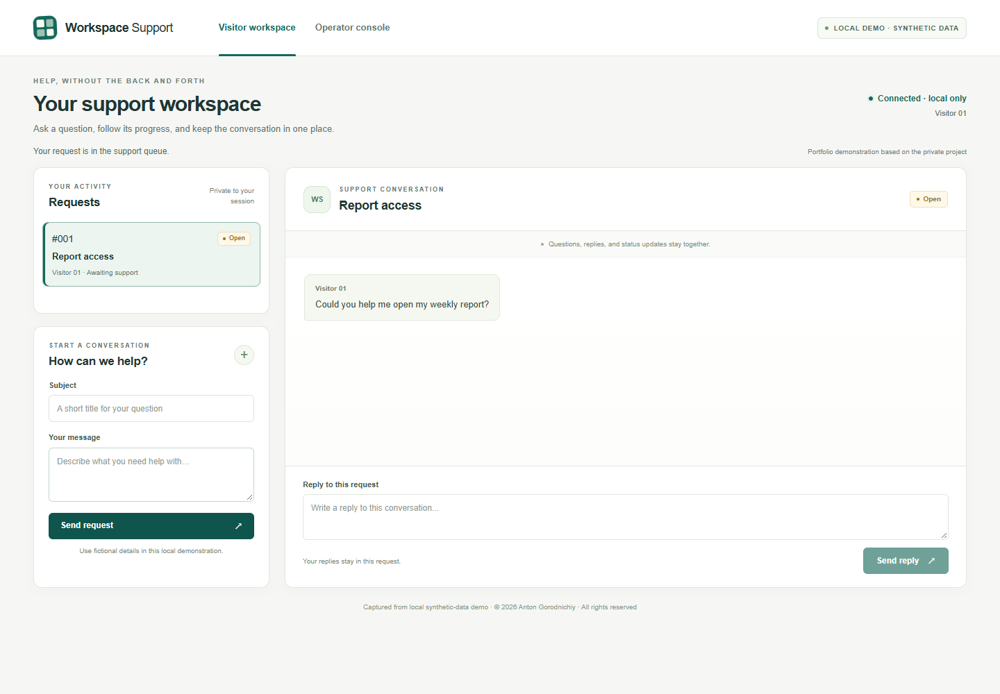
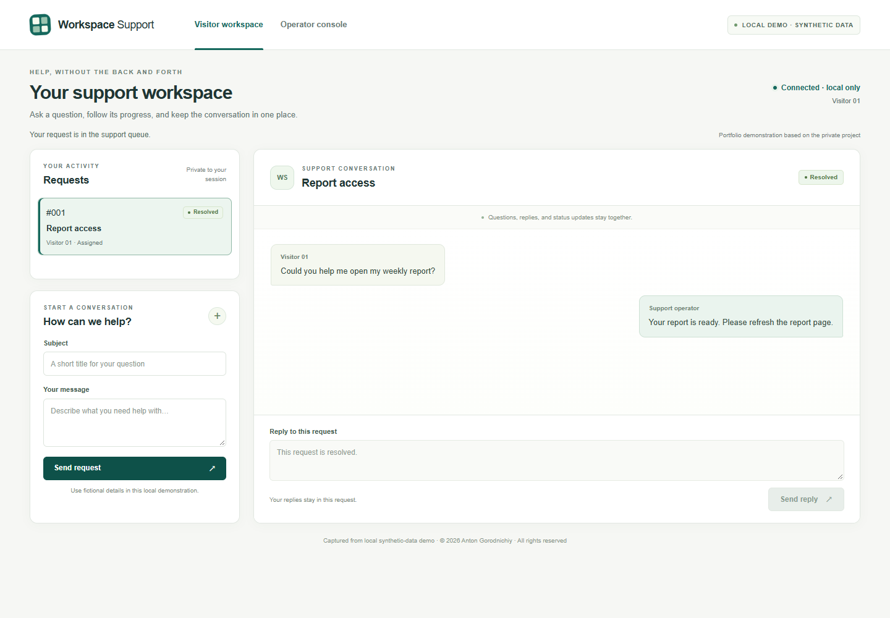
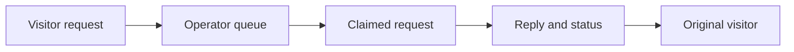

# Web Operations & Support Platform

**Turn a website question into an assigned support request and return the reply to the right visitor.**

[Watch the continuous 52-second operator demo](assets/support-workflow.webm) · [Visitor result](assets/04-visitor-response.png)

| Visitor sends a request | Operator accepts and replies |
| --- | --- |
|  |  |

*Captured from local synthetic-data demo. This is a **portfolio demonstration based on the private project**: a new narrow support application, including a new web operator console. It is not the original full application's interface or a production deployment.*

## Problem → Solution → Result

A visitor needs an answer, and the team needs clear ownership. The demo saves a request, shows it in an operator queue, supports claiming and replying, and returns the saved reply and status to its owner. A second independent visitor cannot read or change that request.

## What this demonstrates

- Actual browser flow: submit → queue → claim → reply → resolve → visitor sees the reply.
- Separate visitor contexts: unauthorized read and write both return 404.
- Role and action checks, a single winner for competing operator claims, and saved state after application recreation.
- **20 API/guard checks passed**, plus the real browser scenario and recording. Checked 9 November 2026; test output includes one upstream deprecation warning.

*Captured from local synthetic-data demo. The video shows the operator view; these frames also show the visitor result. No real messages, accounts or customer data are involved.*

## How it works

The narrow demo uses **Python, FastAPI, SQLite and vanilla HTML/CSS/JavaScript**. The key invariant is simple: a request can be read or changed only in its authorized context. Browser actions and database changes are real; external integrations are disabled.

The original private project contains a browser support widget, Python support storage and Telegram operator tools. Those capabilities informed this demonstration. Its new web console is not attributed to the original project or an adjacent application.

## My contribution

I defined requirements and workflow rules, directed AI-assisted development, and used manual testing and debugging to refine the private workflow. The demonstration adds automated API and real-browser evidence; it does not imply I manually wrote every line.

## What I can deliver for a client

- Website request intake with an operator queue and clear ownership.
- A small internal support interface with roles, replies and task status.
- A Python backend integration with agreed acceptance and failure checks.

## Limitations / private source

This verified demo is separate from the full original application. Original visitor-isolation and shared-state deficiencies are **not claimed fixed**. Real Telegram delivery, uploads, production authentication, deployment and load acceptance were not tested. Local demo tests do not establish production readiness or customer results.

Private implementation — public case study. Source code is not publicly available.

[Discuss a similar workflow](CONTACT.md) · [Portfolio](PORTFOLIO.md)

© 2026 Anton Gorodnichiy. All rights reserved. [Rights and reuse](RIGHTS.md).
