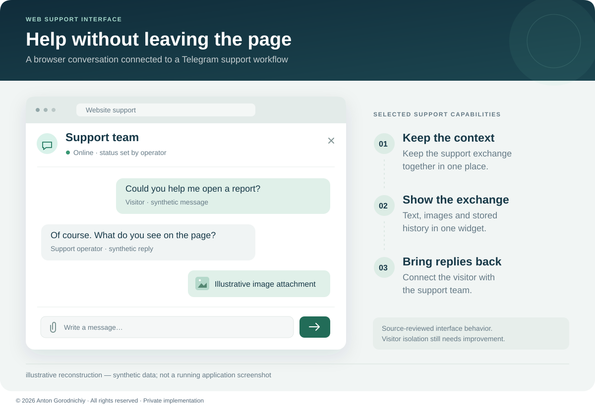
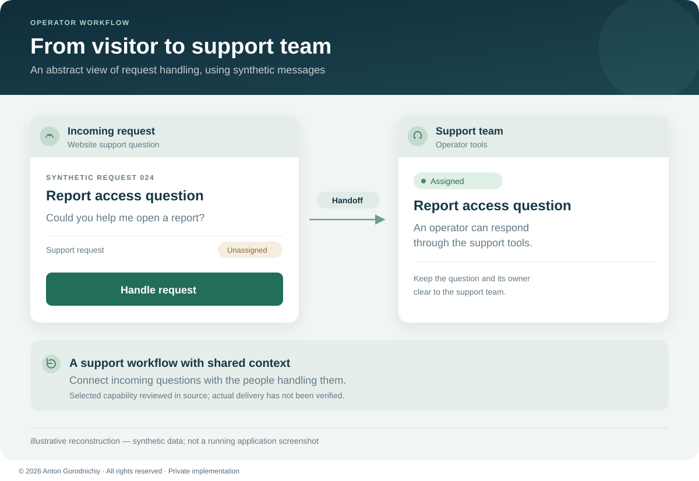
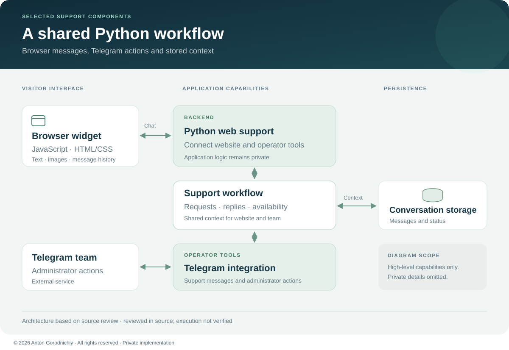

# Web Operations & Support Platform

Connect website questions to a Telegram support team, with stored conversations and explicit request ownership.

**Private implementation — public case study. Source code is not publicly available.**

**Status:** MVP; **reviewed in source; execution not verified**.

| Problem | Solution | Result |
| --- | --- | --- |
| Website visitors need help, while the support team works in Telegram. | A browser chat widget and Python backend connect visitor questions to operator tools. | The reviewed implementation contains stored conversations, operator replies, availability controls and request assignment. Deployment and business impact have not been verified. |

*Illustrative reconstruction — synthetic data; not a running application screenshot. The layout and English copy were created for this case study.*

## My role

I designed and implemented the browser support workflow, Python backend, conversation storage and Telegram operator tools. My work included administrator access checks, request ownership and handling failed handoffs.

## Main features

- **Chat inside a website:** an embeddable widget supports text, images, conversation history and an unread indicator.
- **Telegram operator replies:** browser messages are forwarded to the configured support recipients; administrators can reply through bot actions.
- **Operator-set availability:** conversation status can be changed from Telegram and reflected in the browser interface.
- **Request ownership:** administrators can take responsibility for incoming requests.
- **Stored conversation context:** the backend retains messages and conversation status for the support exchange.

## Engineering approach

The web and operator tools share a Python backend so that messages and actions use the same application logic. Administrator checks and explicit request ownership support coordinated handling. Implementation details remain private.

*Illustrative reconstruction — synthetic data; not a running application screenshot. These abstract message cards do not reproduce a private layout.*

## Architecture and stack

**Python · FastAPI · aiogram · SQLAlchemy · SQLite · Alembic · Jinja2 · JavaScript · HTML/CSS.** Test files are present; no passing test result is claimed.

*Architecture diagram based on source review; external delivery and runtime behavior were not exercised.*

## What I can build for a client

- A website support widget connected to a Telegram operator workflow.
- An internal request intake and assignment flow with roles and clear ownership.
- A Python API and database layer for a small support or operations tool, with agreed acceptance checks.

## Status and limitations

This case covers the Python backend's support widget, conversation storage and administrator request workflow. Adjacent landing pages, a separate work-panel application and a separate Node.js widget are outside this case.

The reviewed MVP needs stronger visitor isolation and separation of shared state before use with independent customers. Delivery reliability, image handling, retention and abuse controls need further work. The reviewed copy also has incomplete page assets.

No application, bot or test suite was run for this case study. End-to-end behavior, deployment, concurrent operation and production readiness remain unverified. The neutral visuals illustrate selected support features and do not imply that the underlying limitations were fixed.

[Discuss a similar project](CONTACT.md) · [Portfolio](PORTFOLIO.md)

© 2026 Anton Gorodnichiy. All rights reserved. [Rights and reuse](RIGHTS.md).
